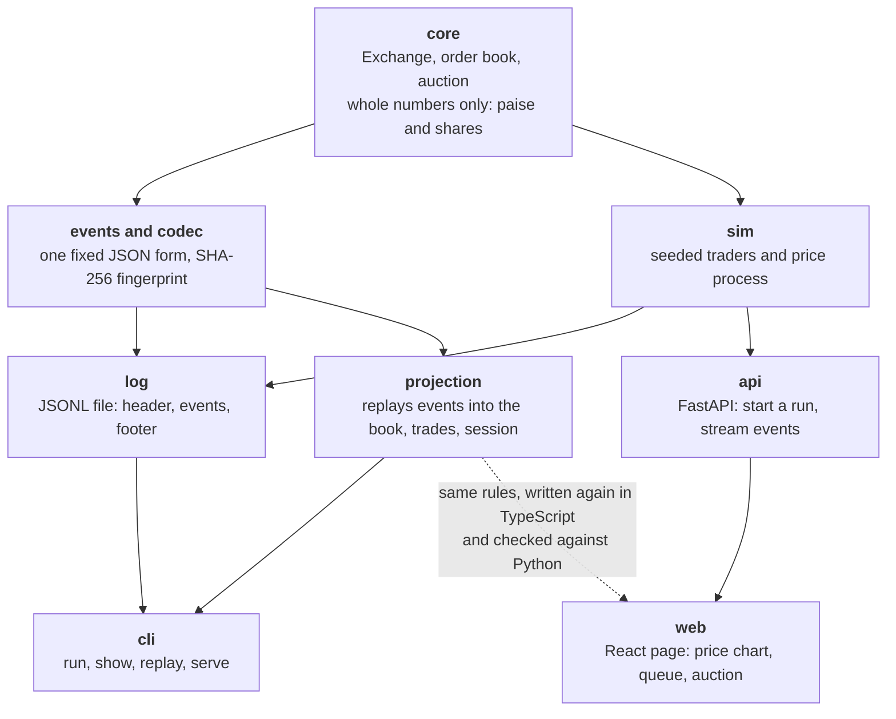
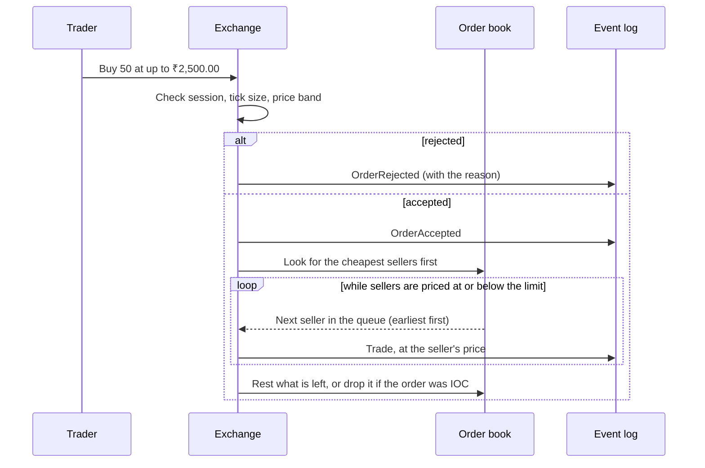
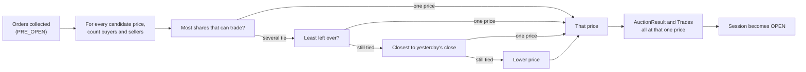

# How Market Lab is put together

Everything is built around one idea: **the event log is the truth.** The exchange does not store "the state of the
market". It appends events (an order was accepted, a trade happened, the session changed), and anything you want to
know, such as the order book, the price chart or the opening auction, is worked out by reading those events in order.

## The layers

Each layer only knows about the ones above it in this picture. The exchange knows nothing about files, the web or the
simulator, which is what makes it easy to test on its own.

## What happens to one order

A trader sends a buy order. The exchange checks it, tries to match it against the queue of sellers, and records every
step as an event. Nothing else changes anything.

## The opening auction

Before the market opens, orders are collected and nothing trades. Then one price is chosen for everyone.

## Why the web page recomputes things

The web page does not ask the server "what does the book look like?". It receives the same events and folds them
itself (`web/src/lib/market.ts`, `web/src/lib/auction.ts`). That keeps the server simple and lets you scrub through the
day with no waiting. The risk is that the two implementations drift apart, so a test feeds the TypeScript code a day
generated by the Python code and checks that both agree. The auction screen is checked the same way on 40 simulated
mornings.
